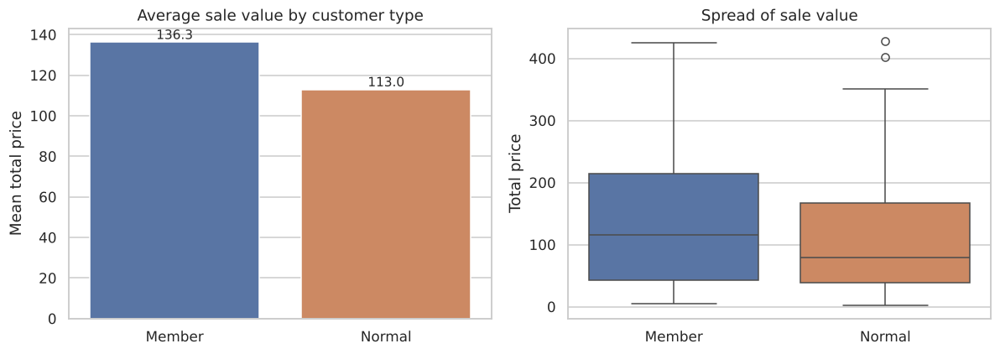

# Supermarket Sales: Exploratory Data Analysis

**Course:** MIS 311 – Introduction to Business Analytics  
**Tools:** Python (pandas, matplotlib, seaborn), Jupyter Notebook  
**Business question:** Where does revenue come from, and which customer or store segments deserve attention?

Full analysis with code: [`supermarket-sales_EDA.ipynb`](supermarket-sales_EDA.ipynb)

---

## 1. Data Overview

| Item | Detail |
|---|---|
| Source | MIS 311 course datasets (`10_Supermarket Sale.xlsx`), see References |
| Size | 253 rows x 8 columns (250 rows after cleaning) |
| Context | Transaction-level sales from a supermarket chain: 2 branches (A, B), 3 cities (New York, Chicago, Los Angeles) |
| Columns | `sale_id`, `branch`, `city`, `customer_type`, `product_name`, `product_category`, `quantity`, `total_price` |

Each row is one sale. `total_price` is the sale revenue (currency not stated) and `quantity` is the number of units.

## 2. Data Cleaning

**Missing values** (12 cells in 3 columns):

| Column | Missing | Method | Why |
|---|---|---|---|
| `customer_type` | 3 | Filled with "Unknown" | Cannot be inferred, keeps the revenue |
| `product_category` | 6 | Filled with "Unknown" | Cannot be recovered from `product_name` (see note) |
| `quantity` | 3 | Filled with the median (11) | Robust for a numeric column; `total_price` is complete |

**Duplicates:** 3 exact duplicate rows (same `sale_id`, same values) were removed to avoid double counting revenue. 253 → 250 rows, 0 missing values left.

> **Data-quality note:** every product appears under every category (e.g. Shampoo is labelled "Fruits" 17 times), so `product_category` does not match `product_name`. I therefore did not analyse category results and focused on customer type and city.

## 3. Descriptive Statistics

| | quantity | total_price |
|---|---|---|
| Mean | 10.62 | 124.19 |
| Median | 11 | 95.43 |
| Std | 5.99 | 102.98 |
| Min / Max | 1 / 20 | 2.18 / 427.14 |

Total revenue is **31,046**. Sale value is right-skewed (mean above median), and quantity and total price are strongly correlated (r = 0.72).


## 4. Key Insights

### Insight 1: Member customers spend more per sale than Normal customers
Members have an average sale of **136.30** versus **112.99** for Normal customers (+21%), and a median of 115.56 versus 79.33. Members make 53% of transactions but generate **57.7% of revenue**, because they buy slightly more units (11.2 vs 10.2) at a higher unit price. This suggests the membership programme attracts higher-value shoppers, so retaining and growing members is a sensible priority. *Caution: the difference is suggestive rather than conclusive (Welch t-test p ≈ 0.07).*



### Insight 2: Chicago earns the most revenue with the fewest transactions
Chicago generates **11,133 (35.9%)** of revenue from only 77 transactions, ahead of New York (10,964 from 95 transactions) and Los Angeles (8,949 from 78). Its average sale is **144.59** versus about 115 in both other cities, while New York has the most transactions but the lowest basket (9.9 units). This shows that transaction count alone is misleading: New York could grow revenue by raising basket size, and Chicago's practices are worth studying. *Caution: Chicago's per-sale edge is borderline (p ≈ 0.05).*


## 5. Limitations
- Small sample (250 sales), no dates, so no time trends.
- Currency is not given and category labels are unreliable.
- Branch B exists only in Los Angeles, so branch and city overlap; city was used.

## 6. How to Reproduce
```bash
pip install pandas matplotlib seaborn scipy openpyxl jupyter
jupyter notebook supermarket-sales_EDA.ipynb
```

## References
Hunter, J. D. (2007). Matplotlib: A 2D graphics environment. *Computing in Science & Engineering, 9*(3), 90–95. https://doi.org/10.1109/MCSE.2007.55

McKinney, W. (2010). Data structures for statistical computing in Python. In *Proceedings of the 9th Python in Science Conference* (pp. 56–61). https://doi.org/10.25080/Majora-92bf1922-00a

MIS 311 – Introduction to Business Analytics. (n.d.). *Datasets for assessment: Supermarket sale* [Data set]. Eastern International University.

Waskom, M. L. (2021). seaborn: Statistical data visualization. *Journal of Open Source Software, 6*(60), Article 3021. https://doi.org/10.21105/joss.03021
