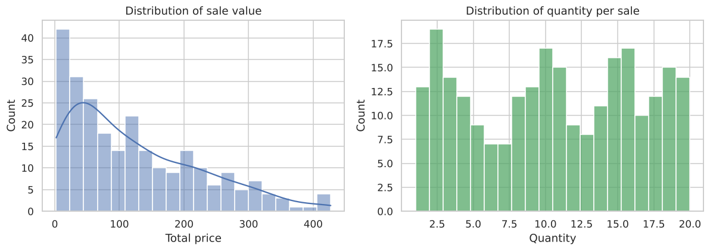
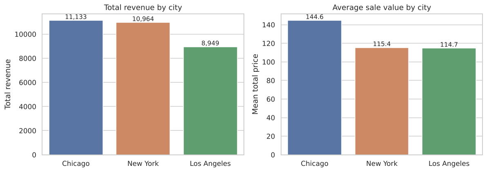

# Supermarket Sales Analysis

> **MIS 311 – Introduction to Business Analytics** | Individual Assignment #1
> **Author:** [Phan THanh Hung] | **IRN:** [1932300310]
> **Tools:** Python (pandas, matplotlib, seaborn), Jupyter Notebook

**Business question:** Where does the supermarket's revenue come from, and which customer or store segments deserve attention?
---

## 1. Data Overview

- **Source:** MIS 311 course dataset, `10_Supermarket Sale.xlsx` (see References)
- **Size:** 253 rows × 8 columns (250 rows after cleaning)
- **What one row means:** one sale at a supermarket chain with 2 branches (A, B) and 3 cities (New York, Chicago, Los Angeles)
- **Columns:** `sale_id`, `branch`, `city`, `customer_type` (Member/Normal), `product_name`, `product_category`, `quantity`, `total_price`

This kind of sales data helps a retailer see which customers and locations bring in the most revenue, so that marketing and store decisions can be based on evidence.

---

## 2. Data Cleaning

### 2.1 Missing values (12 cells)

| Column | Missing | What I did | Why |
|---|---|---|---|
| `quantity` | 3 | Filled with the median (11) | The median is not affected by very large or very small orders, so it is a safer choice than the mean for skewed data. Only 3 of 250 rows were affected, so the results barely change. |
| `customer_type` | 3 | Filled with "Unknown" | A customer's type cannot be worked out from the other columns, and guessing would create false data. Labelling it "Unknown" keeps the sale and its revenue in the dataset. |
| `product_category` | 6 | Filled with "Unknown" | The category could not be taken from `product_name`, because the same product appears under many categories (see the note below). |

> **Data-quality note:** every product appears under every category (for example, Shampoo is labelled "Fruits" 17 times), so `product_category` does not match `product_name`. Because of this I did not analyse results by category.

### 2.2 Duplicates

I found **3 rows** that were exact copies of another row (same `sale_id` and same values), so I removed them. If they had stayed, the same sale would be counted twice, which would overstate total revenue and the number of transactions.

**Result:** 253 → 250 rows, 0 missing values, 0 duplicate sale IDs.

---

## 3. Descriptive Statistics

| | quantity | total_price |
|---|---|---|
| Mean | 10.62 | 124.19 |
| Median | 11 | 95.43 |
| Std | 5.99 | 102.98 |
| Min / Max | 1 / 20 | 2.18 / 427.14 |

- Total revenue: **31,046**
- Correlation between `quantity` and `total_price`: **0.72**

The mean sale (124.19) is higher than the median (95.43), so the data is right-skewed: a small number of very large orders (up to 427.14) pull the average up. This means the median describes a typical sale better than the mean. The correlation of 0.72 shows that sales with more units usually have a higher total price.

---

## 4. Key Insights

### Insight 1: Member customers spend more per sale than Normal customers

| | Sales | Mean sale | Median sale | Share of revenue |
|---|---|---|---|---|
| Member | 131 | 136.30 | 115.56 | 57.7% |
| Normal | 116 | 112.99 | 79.33 | 42.3% |

Members spend 136.30 per sale on average compared with 112.99 for Normal customers (about 21% more), and they generate 57.7% of revenue from about 53% of sales. This suggests that members are higher-value shoppers, because they buy slightly more units per sale (11.2 vs 10.2) at a higher unit price. The supermarket could focus on keeping and growing its membership, although the difference is suggestive rather than conclusive (Welch t-test p ≈ 0.07).

### Insight 2: Chicago earns the most revenue with the fewest transactions

| City | Transactions | Total revenue | Mean sale | Share |
|---|---|---|---|---|
| Chicago | 77 | 11,133 | 144.59 | 35.9% |
| New York | 95 | 10,964 | 115.41 | 35.3% |
| Los Angeles | 78 | 8,949 | 114.73 | 28.8% |

Chicago earns the most revenue (11,133, or 35.9%) even though it has the fewest transactions (77), because its average sale is 144.59 compared with about 115 in New York and Los Angeles. In contrast, New York has the most transactions (95) but the smallest basket (9.9 units per sale), which shows that counting transactions alone can be misleading. The business could offer bundle deals in New York to raise basket size and study what works in Chicago, keeping in mind that Chicago's higher average is only borderline significant (p ≈ 0.05).

---

## 5. Limitations

- Only 250 sales and no dates, so I could not look at trends over time.
- Currency is not stated, and the category labels are unreliable.
- Branch B exists only in Los Angeles, so branch and city overlap; I used city.
- The results describe this sample only and may not apply to the whole chain.

